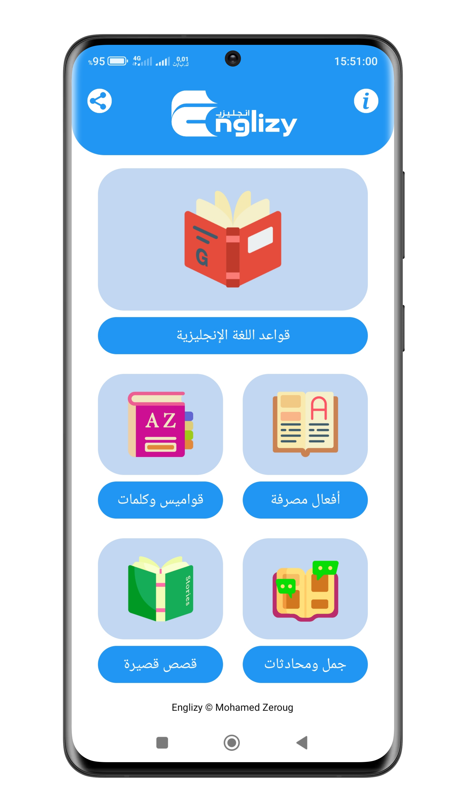
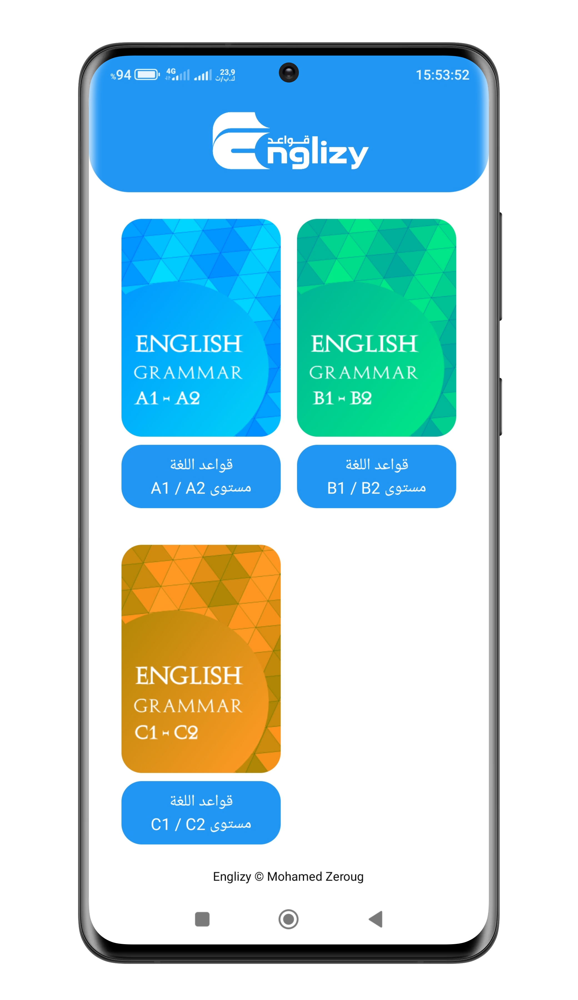
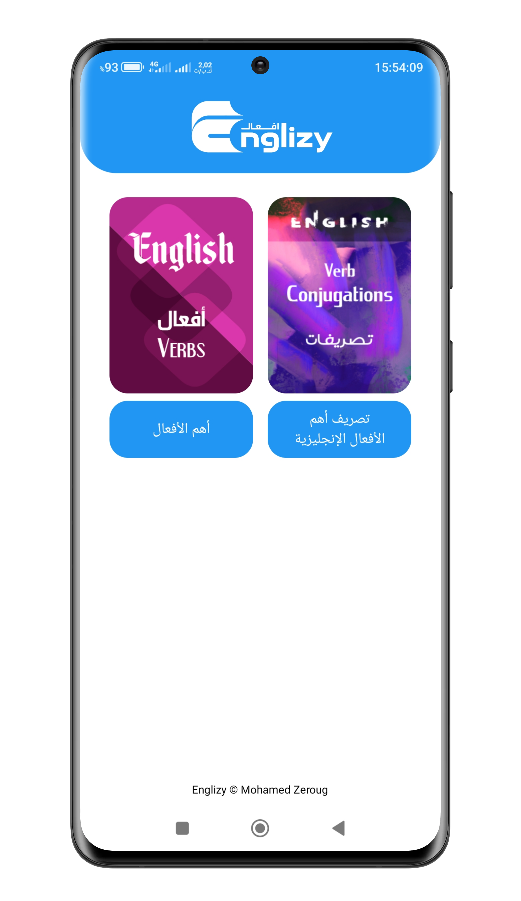
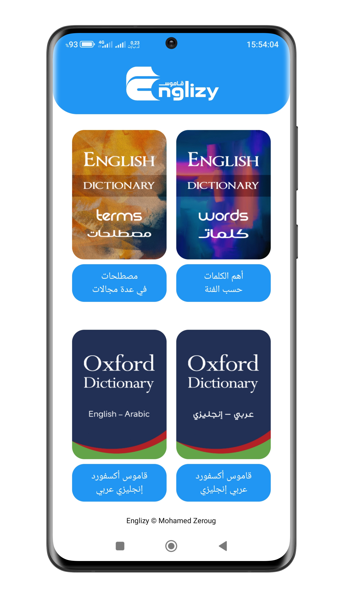
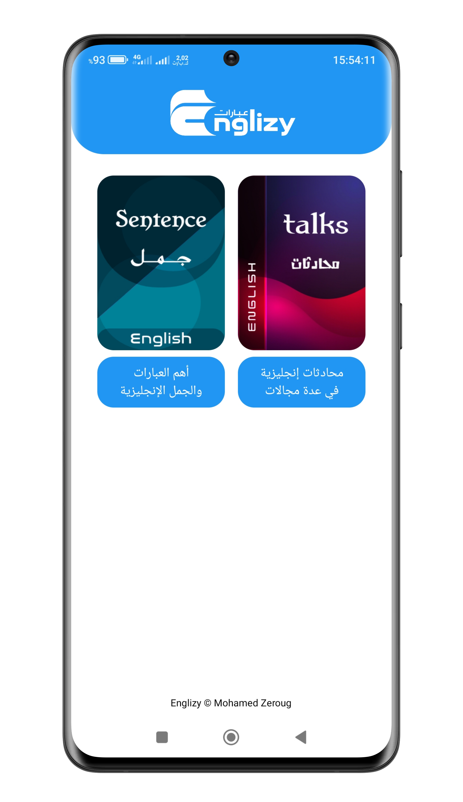
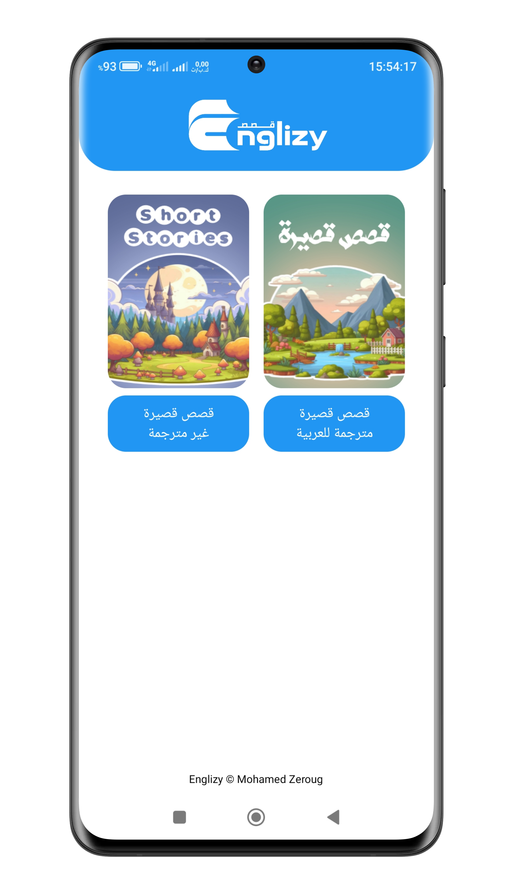
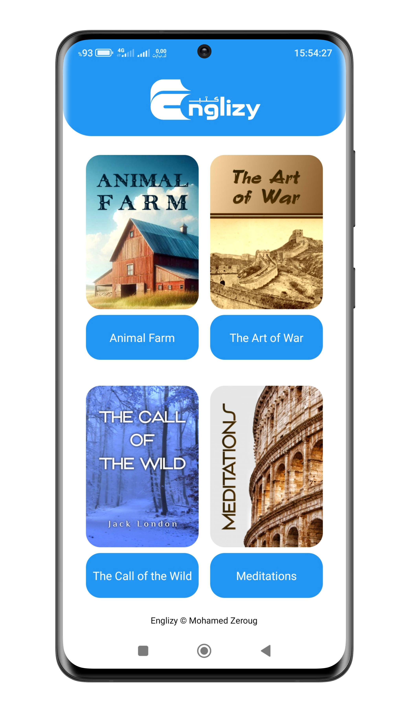
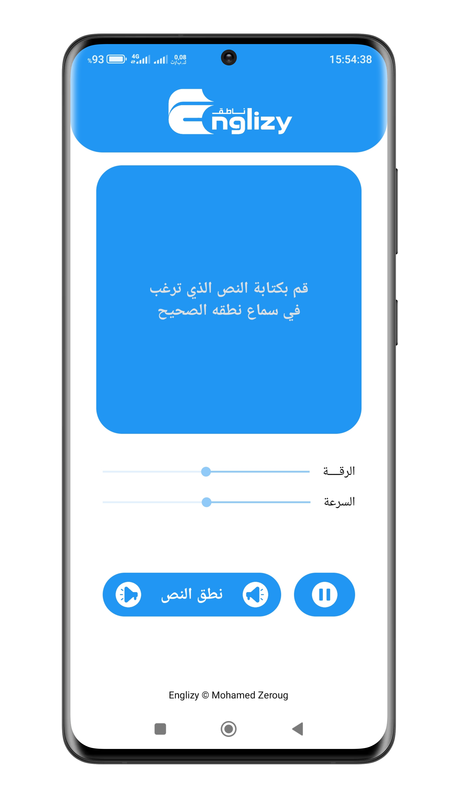
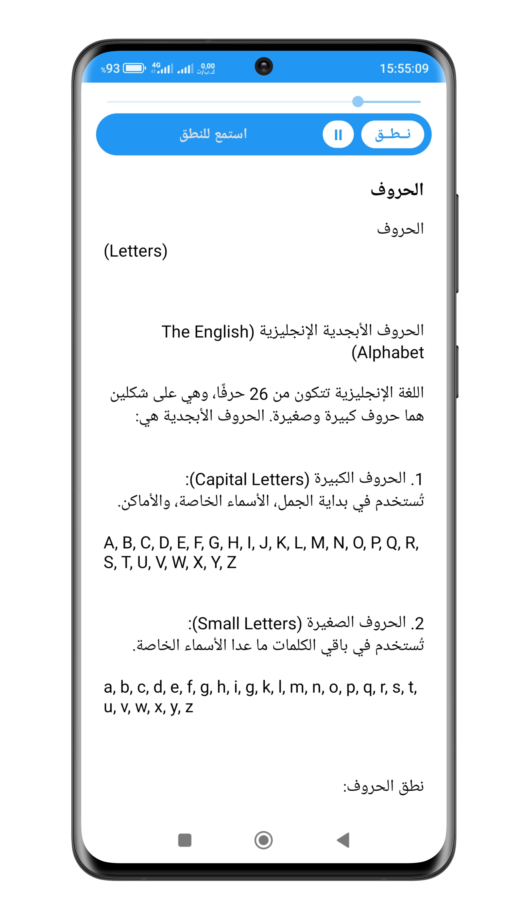

# إنجليزي Englizy

  

# تطبيق لتعلم اللغة الإنجليزية للناطقين بالعربية

تطبيق تعليمي شامل مصمم لتطوير مهاراتك في اللغة الإنجليزية دون الحاجة للاتصال بالإنترنت.

# محتويات التطبيق

- أهم قواعد اللغة الإنجليزية مقسمة إلى عدة مستويات تعليمية.

- قواميس متنوعة للكلمات والتعبيرات، بالإضافة إلى مئات العبارات والجمل.

- أهم الأفعال الإنجليزية مصرفة في جميع الصيغ الممكنة، بما في ذلك الأفعال الشاذة.

- مئات القصص القصيرة وعشرات المحادثات اليومية.

- عشرة كتب كاملة وذات تقييم عالٍ.

- محول نص إلى كلام مع خيارات صوت قابلة للتخصيص.

# المميزات

### مرونة عالية

متجاوب بالكامل ومُحسّن لجميع أحجام الشاشات، مما يضمن تجربة سلسة لكل مستخدم.

### العمل دون اتصال بالإنترنت

مصمم لتوفير المحتوى التعليمي حتى في حال عدم توفر اتصال بالإنترنت — مثالي للمستخدمين ذوي الاتصال المحدود.

### محتوى حصري

مجموعة غنية من المواد التعليمية المتوفرة حصرياً داخل هذا التطبيق الواحد.

### مجاني بالكامل

لا يتطلب أي مدفوعات وخالٍ تماماً من الإعلانات المزعجة — استمتع بالتجربة الكاملة دون أي تكلفة.

# الموقع الرسمي

لمزيد من المعلومات حول التطبيق، بما في ذلك الشروط والأحكام وسياسة الخصوصية، يرجى زيارة: [الموقع الرسمي](https://englizyapp.blogspot.com).

# سجل التغييرات

للاطلاع على التغييرات في التحديث الأخير، يرجى الانتقال إلى الموقع التالي: [سجل التغييرات](https://englizyapp.blogspot.com/p/updatelog.html).

# لقطات الشاشة

  
  
  

  
  
  

  
  
  

